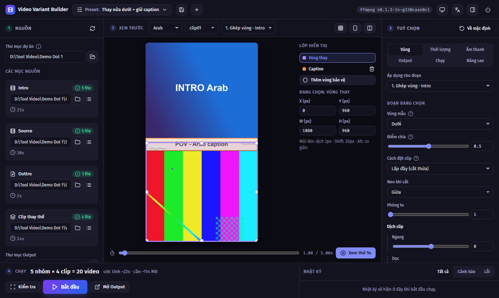
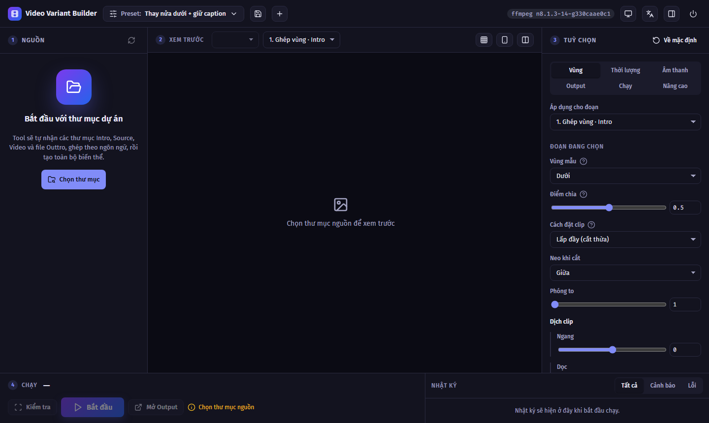
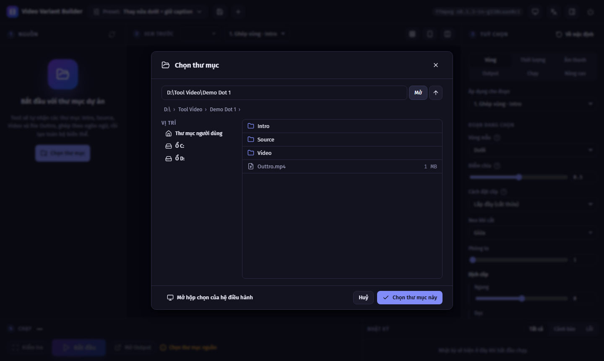
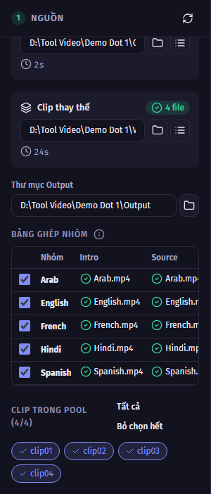
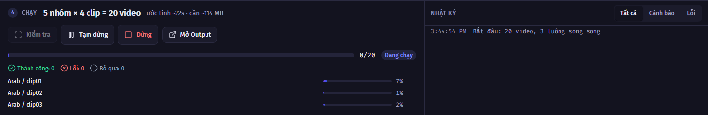
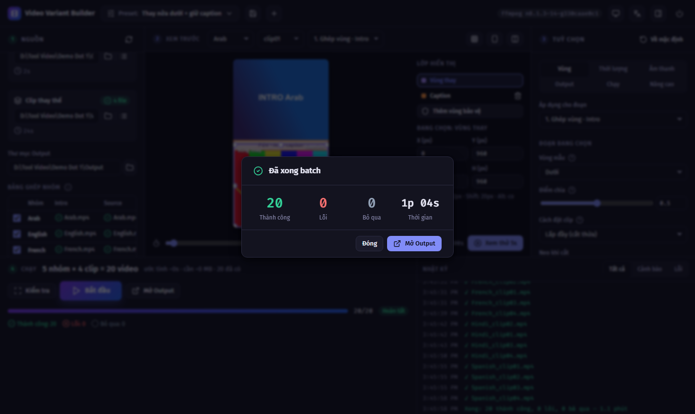
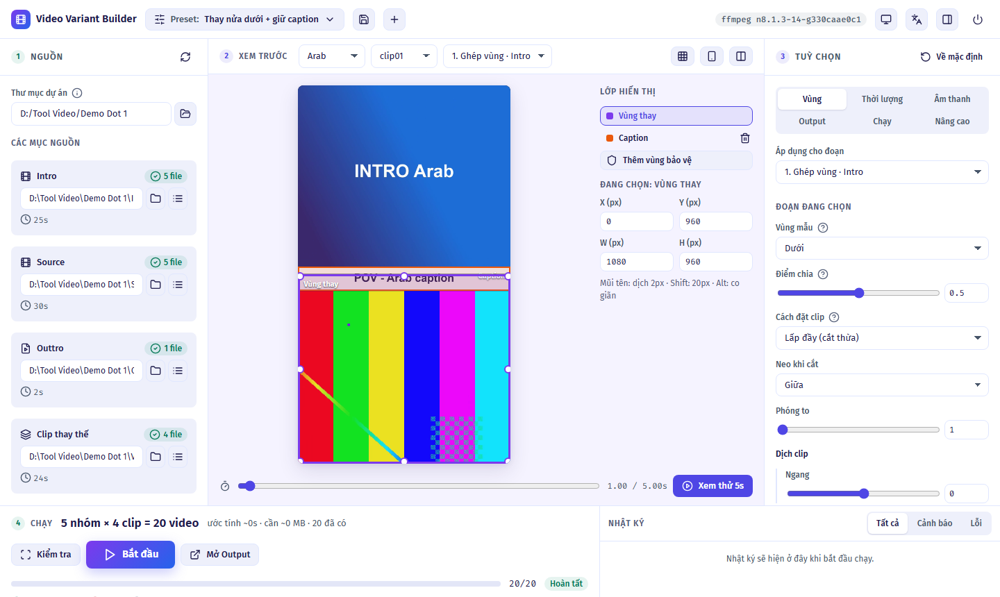

<div align="center">


# Video Variant Builder

**Ghép video quảng cáo hàng loạt — chọn thư mục, bấm một nút, ra đủ mọi phiên bản.**

[⬇ Tải bản mới nhất](https://github.com/codelord-commits/Tool-Video/releases/latest) ·
[Hướng dẫn nhanh](#-bắt-đầu-trong-5-phút) ·
[Câu hỏi thường gặp](#-gặp-sự-cố)

</div>



---

## Tool này giúp gì cho bạn?

Bạn có **1 video quảng cáo làm bằng nhiều ngôn ngữ** và **nhiều clip** muốn thử. Làm tay từng bản trên CapCut thì rất lâu.
Tool này làm **tất cả các bản cùng lúc**:

```
   Intro (mỗi ngôn ngữ 1 file)          Clip mới (nhiều clip)
   ┌──────────────┐                    ┌──────┐ ┌──────┐ ┌──────┐
   │ ảnh + chữ    │  ← giữ nguyên      │clip01│ │clip02│ │clip03│ …
   │──caption─────│  ← giữ nguyên      └──────┘ └──────┘ └──────┘
   │ nửa dưới     │  ← THAY bằng clip mới
   └──────────────┘
            +  Source cùng ngôn ngữ  +  Outtro
                         ↓
   5 ngôn ngữ × 10 clip = 50 video hoàn chỉnh, tự xếp vào từng thư mục
```

- ✅ **Giữ nguyên giọng đọc** và **dải chữ caption** của Intro.
- ✅ Tự nối đúng phần thân video **cùng ngôn ngữ** (Arab đi với Arab, French đi với French…).
- ✅ Tự hiểu tên file khác nhau: `Arabic` = `Arab` = `AR`, `Por` = `Portuguese`, `Thailand` = `Thai`…
- ✅ Video ra chuẩn TikTok / Reels / Shorts (dọc 1080×1920), đăng được ngay.
- ✅ Mọi thứ chạy **trên máy của bạn**, không tải video lên mạng.

Ngoài kiểu "thay nửa dưới", tool còn làm được: thay 3 giây đầu (hook), thay nửa trên, chèn clip vào giữa, đặt clip vào ô nhỏ ở góc (PiP)…

---

## 🚀 Bắt đầu trong 5 phút

### Bước 1 — Tải và mở tool

1. Vào trang **[Releases](https://github.com/codelord-commits/Tool-Video/releases/latest)**, tải file **`VideoVariantBuilder-windows.zip`**
   (máy Mac thì tải `VideoVariantBuilder-macos.zip`).
2. **Giải nén** file zip: chuột phải → *Extract All…* → chọn nơi lưu, ví dụ `D:\VideoVariantBuilder`.
   > ⚠️ Đừng chạy trực tiếp bên trong file zip, tool sẽ không hoạt động.
3. Mở thư mục vừa giải nén, **nhấp đúp `VideoVariantBuilder.exe`**.
4. Một **cửa sổ đen nhỏ** hiện ra, rồi **trình duyệt tự mở** giao diện tool.

> 💡 **Cửa sổ đen là "động cơ" của tool — đừng đóng nó** khi đang dùng. Đóng cửa sổ đen = tắt tool.
> Lỡ đóng trình duyệt cũng không sao: mở lại `VideoVariantBuilder.exe` là được, video đang làm vẫn chạy tiếp.

<details>
<summary><b>Windows báo "Windows protected your PC"?</b></summary>

Bấm **More info** → **Run anyway**. Cảnh báo này xuất hiện vì tool chưa mua chứng chỉ ký số, không phải vì có virus.
</details>

<details>
<summary><b>Máy Mac báo "không thể mở vì không xác định được nhà phát triển"?</b></summary>

Chuột phải (hoặc Control + bấm) vào `VideoVariantBuilder.app` → chọn **Open** → bấm **Open** lần nữa. Chỉ cần làm 1 lần đầu.
</details>

<details>
<summary><b>Phần mềm diệt virus chặn hoặc xoá file?</b></summary>

Tool có kèm `ffmpeg.exe` (phần mềm xử lý video miễn phí, rất phổ biến). Một số phần mềm diệt virus nhầm lẫn file này.
Hãy thêm thư mục tool vào danh sách **loại trừ (exclusion)** của phần mềm diệt virus rồi giải nén lại.
</details>

### Bước 2 — Sắp xếp video vào thư mục

Tạo **1 thư mục cho mỗi đợt làm** (ví dụ `Dot 1`) và xếp video như sau:

```
📁 Dot 1
 ├── 📁 Intro      ← đoạn mở đầu, MỖI NGÔN NGỮ 1 FILE
 │     ├── Arab.mp4
 │     ├── French.mp4
 │     └── Hindi.mp4
 ├── 📁 Source     ← phần thân, TÊN FILE TRÙNG NGÔN NGỮ với Intro
 │     ├── Arab.mp4
 │     ├── French.mp4
 │     └── Hindi.mp4
 ├── 📁 Video      ← các clip mới để thay vào (đặt tên gì cũng được)
 │     ├── clip01.mp4
 │     └── clip02.mp4
 └── 🎬 Outtro.mp4 ← đoạn kết, dùng chung cho mọi video
```

**3 quy tắc cần nhớ:**
1. File trong `Intro` và `Source` phải **cùng tên ngôn ngữ** (`Arab.mp4` ↔ `Arab.mov` là được, khác đuôi không sao).
2. Tên thư mục viết đúng `Intro`, `Source`, `Video`. Hoa hay thường đều được. File kết đặt tên `Outtro`, `Outro` hoặc `Ending`.
3. Nhận các định dạng: `.mp4`, `.mov`, `.m4v`, `.mkv`, `.webm`, `.avi`.

### Bước 3 — Chọn thư mục

Bấm nút **Chọn thư mục**.



Trong cửa sổ hiện ra, đi tới thư mục `Dot 1` rồi bấm **Chọn thư mục này**.
Mẹo: có thể **dán đường dẫn** vào ô trên cùng (ví dụ `D:\Khach A\Dot 1`) rồi bấm **Mở**.



### Bước 4 — Kiểm tra bảng ghép

Cột bên trái hiện các mục tool vừa tìm thấy, kèm **bảng ghép nhóm**: mỗi dòng là 1 ngôn ngữ.



| Thấy gì | Nghĩa là |
|---|---|
| ✓ **xanh** | Có file, ổn |
| Ô **vàng** | Thiếu file — chọn file đúng trong danh sách |
| Ô **đỏ** | Có 2 file trùng tên ngôn ngữ — chọn 1 file |
| Dòng *"Không dùng tới"* | File thừa, không có Intro tương ứng |

- **Bỏ tick** ngôn ngữ nào không muốn làm.
- Ở mục **Clip trong pool**, bấm vào tên clip để bỏ chọn clip không muốn dùng.

<br clear="right">

### Bước 5 — Xem trước (nên làm)

Ở giữa màn hình là **khung xem trước** video thành phẩm.

- **Khung tím** = phần sẽ bị thay bằng clip mới. **Khung cam** = phần được giữ lại (dải caption).
- **Kéo khung** bằng chuột để chỉnh vị trí, kéo các **chấm tròn ở mép** để đổi kích thước.
  Nếu caption của bạn nằm cao hơn hoặc thấp hơn, kéo khung cam cho trùng với caption.
- Đổi **Nhóm** / **Clip** ở thanh trên để xem các bản khác; kéo **thanh thời gian** phía dưới để xem giây khác.
- Bấm **▶ Xem thử 5s** để xem một đoạn video ngắn có cả tiếng.

### Bước 6 — Bấm Bắt đầu

Ở thanh dưới cùng, tool cho biết sẽ tạo bao nhiêu video, mất khoảng bao lâu và cần bao nhiêu dung lượng.
Bấm **▶ Bắt đầu**.



- Muốn dùng máy việc khác một lúc: bấm **Tạm dừng**, rồi **Tiếp tục**.
- Muốn huỷ: bấm **Dừng**. Video đã xong vẫn được giữ lại.
- Xong sẽ có thông báo kèm tiếng "ting". Bấm **Mở Output** để xem video.



### Video thành phẩm nằm ở đâu?

Trong thư mục **`Output`** bên trong thư mục dự án, chia theo ngôn ngữ:

```
📁 Dot 1
 └── 📁 Output
       ├── 📁 Arab      Arab_clip01.mp4, Arab_clip02.mp4 …
       ├── 📁 French    French_clip01.mp4 …
       ├── 📄 manifest.csv   ← danh sách tất cả video (mở bằng Excel)
       └── 📄 errors.log     ← chỉ có khi có video lỗi
```

> 💡 **Chạy lại cùng thư mục?** Video nào đã có sẽ được **bỏ qua**, tool chỉ làm video còn thiếu.
> Muốn làm lại 1 video: xoá file đó trong `Output` rồi bấm Bắt đầu.

---

## 🎛️ Chỉnh thêm (không bắt buộc)

Cột bên phải là **Tuỳ chọn**. Rê chuột vào dấu **?** cạnh mỗi ô để xem giải thích. Hay dùng nhất:

| Muốn… | Vào tab | Chỉnh |
|---|---|---|
| Clip mới lấp kín vùng hoặc hiện đủ hình | **Vùng** | *Cách đặt clip*: Lấp đầy / Vừa khít |
| Lấy phần giữa của clip thay vì phần đầu | **Thời lượng** | *Bắt đầu clip từ*: `center` |
| Clip ngắn hơn Intro thì đứng hình thay vì lặp lại | **Thời lượng** | *Khớp thời lượng* |
| Dùng tiếng của clip mới thay giọng Intro | **Âm thanh** | *Âm thanh đoạn*: Tiếng clip pool |
| Âm lượng các video đều nhau | **Âm thanh** | *Chuẩn hoá loudness*: `-14` |
| Video nhẹ hơn / nét hơn | **Output** | *Chất lượng* |
| Làm nhanh hơn | **Chạy** | *Số video song song* (2–4) |
| Đổi tên file video ra | **Output** | *Mẫu tên file* |

Nút **↺ Về mặc định** đưa tab đang mở về như cũ.

**Giao diện sáng / tối, tiếng Việt / English:** dùng 2 nút ở góc trên bên phải.



### Lưu cấu hình để dùng lại (preset)

Đã chỉnh xong và muốn lần sau dùng lại? Bấm menu **Preset** ở góc trên → **Lưu thành preset mới…**, đặt tên, xong.
Lần sau chỉ cần chọn preset đó trong menu. Có thể **Xuất file .json** để gửi cho đồng nghiệp, người kia dùng **Nhập file .json**.

Các kiểu làm có sẵn trong menu Preset:

| Preset | Dùng khi |
|---|---|
| **Thay nửa dưới + giữ caption** | Thay nửa dưới Intro, giữ giọng + caption, nối Source + Outtro *(mặc định)* |
| **Thay hook 3s đầu** | 3 giây đầu là clip mới, sau đó là video chính |
| **Thay hook giữ voice** | 3 giây đầu đổi hình nhưng vẫn giữ giọng đọc gốc |
| **Thay nửa trên** | Giống mặc định nhưng thay nửa trên |
| **Chèn clip vào giữa** | Chèn 3 giây clip mới vào giữa video |
| **Chỉ nối theo nhóm** | Chỉ ghép Intro + Source + Outtro theo ngôn ngữ, không thay gì |
| **PiP góc** | Đặt clip mới vào ô nhỏ bo góc ở góc dưới phải |

> Các preset khác (Thay hook, PiP…) dùng thư mục **`Body`** cho video chính và **`Hook`** / **`Video`** cho clip.
> Xem tên thư mục cần có ở cột trái sau khi chọn preset.

---

## 🆘 Gặp sự cố?

| Hiện tượng | Cách xử lý |
|---|---|
| Nút **Bắt đầu** bị mờ | Đọc dòng chữ vàng ngay cạnh nút, tool ghi rõ đang thiếu gì. Bấm **Kiểm tra** để xem danh sách lỗi; bấm vào từng lỗi để tới đúng chỗ. |
| Một ngôn ngữ bị bỏ qua | Thiếu file `Source` cùng tên. Kiểm tra lại tên file, hoặc chọn file thay thế trong ô vàng ở bảng ghép. |
| Báo **"Trùng"** (ô đỏ) | Trong cùng thư mục có 2 file cùng ngôn ngữ (ví dụ `Arab.mp4` và `Arabic.mov`). Chọn 1 file trong ô đỏ hoặc xoá bớt file. |
| Caption bị che một phần | Ở khung xem trước, kéo **khung cam** cho phủ kín dải caption. |
| Clip mới bị cắt mất phần quan trọng | Tab **Vùng** → *Neo khi cắt* (Trên / Dưới / Giữa), hoặc *Cách đặt clip* = Vừa khít. |
| Mất điện / tắt máy giữa chừng | Mở lại tool, chọn lại thư mục dự án → bấm **Tiếp tục job** trên dòng thông báo màu vàng. |
| Video lỗi | Bấm vào dòng đỏ trong **Nhật ký** để xem lý do, rồi bấm **Chạy lại video lỗi**. File thường bị hỏng hoặc đang tải dở. |
| Ổ đĩa đầy | Tool tự **tạm dừng** khi ổ sắp đầy. Xoá bớt file rồi bấm **Tiếp tục**. |
| Trình duyệt báo **"Phiên đã hết hạn"** | Mở lại `VideoVariantBuilder.exe` (vì lý do bảo mật, mỗi lần mở tool có một đường link mới). |
| File trên Google Drive / OneDrive | Tải file về máy trước (chọn *Always keep on this device*), tool cảnh báo nếu file chỉ nằm trên mạng. |

Vẫn chưa được? Tạo [Issue](https://github.com/codelord-commits/Tool-Video/issues) kèm ảnh chụp màn hình và file `errors.log` (nếu có).

---

## 📖 Giải thích từ ngữ

| Từ | Nghĩa |
|---|---|
| **Nhóm** | Một phiên bản của video, thường là **ngôn ngữ** (Arab, French…) |
| **Pool / Clip thay thế** | Các clip mới trong thư mục `Video`, mỗi clip tạo ra 1 video cho mỗi ngôn ngữ |
| **Vùng thay** (khung tím) | Phần khung hình sẽ bị thay bằng clip mới |
| **Vùng bảo vệ** (khung cam) | Phần lấy lại từ video gốc phủ lên trên cùng (caption, logo…) |
| **Preset** | Bộ cấu hình đã lưu cho một kiểu làm video |
| **Output** | Thư mục chứa video thành phẩm |

---

## 👩‍💻 Dành cho người dùng nâng cao

<details>
<summary><b>Chạy từ mã nguồn (cần Python 3.10+)</b></summary>

```bash
git clone https://github.com/codelord-commits/Tool-Video.git
cd Tool-Video
python -m venv .venv
.venv\Scripts\activate          # macOS/Linux: source .venv/bin/activate
pip install -e .
python scripts/get_ffmpeg.py    # tải ffmpeg vào bin/
vvb-web                         # mở giao diện
```
</details>

<details>
<summary><b>Dòng lệnh (CLI) — chạy tự động, không cần giao diện</b></summary>

```bash
vvb run   --preset palm_bottom --project "D:/Khach A/Dot 1"
vvb check --preset palm_bottom --project "D:/Khach A/Dot 1"        # chỉ kiểm tra, không render
vvb run   ... --dry-run | --groups arab,french | --clips clip01,clip02 | --limit 3
vvb run   ... --workers 4 --quality max --existing overwrite --codec h264_nvenc
vvb preview ... --at 1.5 -o preview.png
vvb resume --out "D:/Khach A/Dot 1/Output"
vvb presets list
```
Bản đóng gói: `VideoVariantBuilder.exe cli run --preset …` (cùng tham số).
Thứ tự ưu tiên: **dòng lệnh > preset > mặc định**.
</details>

<details>
<summary><b>Tự viết preset cho kiểu video mới</b></summary>

Xem **[docs/PRESET.md](docs/PRESET.md)**: giải thích từng trường, kèm ví dụ thay hook, PiP, thay tiếng theo nhóm…
</details>

<details>
<summary><b>Đóng góp mã nguồn</b></summary>

Xem **[CONTRIBUTING.md](CONTRIBUTING.md)**.
</details>

---

## Giấy phép

Mã nguồn theo giấy phép **MIT**, xem [LICENSE](LICENSE).
ffmpeg đi kèm bản đóng gói là phần mềm riêng theo giấy phép GPL (`bin/FFMPEG_LICENSE.txt`, mã nguồn tại <https://ffmpeg.org/download.html>).
Font Fira (SIL OFL 1.1), icon Lucide (ISC), Alpine.js (MIT).
